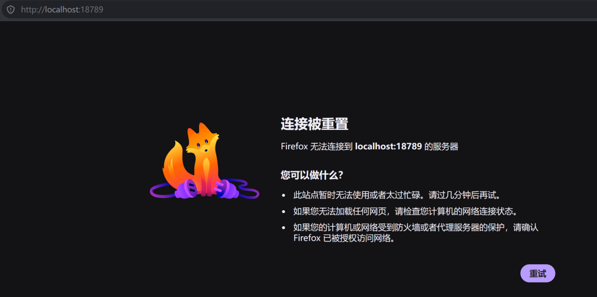
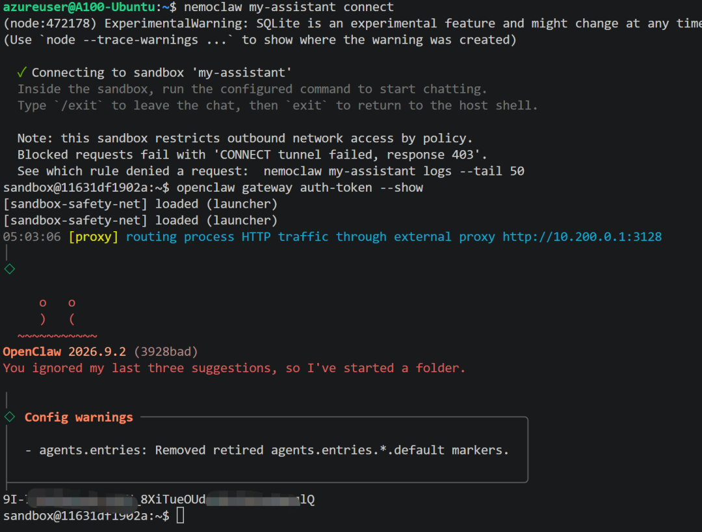
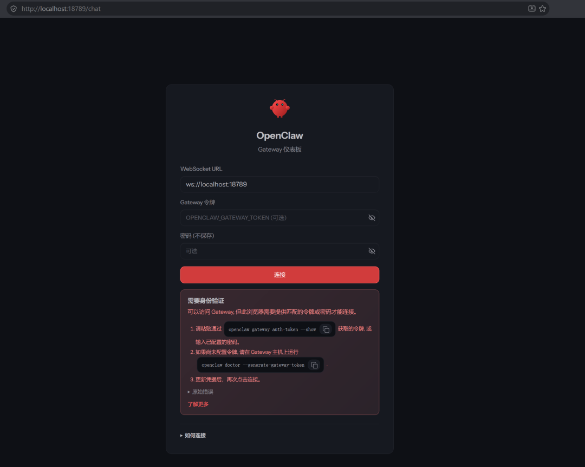
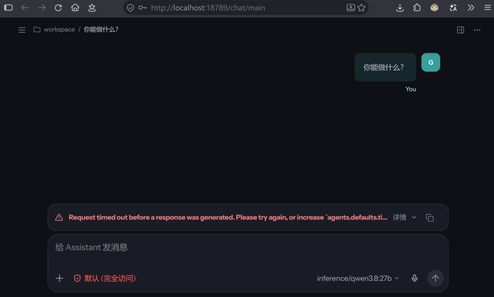

# OpenShell + NemoClaw 本地安全智能体部署指南

本仓库记录在一台单机（NVIDIA A100）上，用 **NVIDIA OpenShell**（沙箱隔离）+ **NemoClaw**（托管层）部署本地安全智能体的完整过程：**安装脚本审查、Ollama 本地推理（qwen3.8:27b，数据不出机）、OpenShell 沙箱策略配置、部署后使用实测与排障**。

> 核心目标：让 coding agent 跑在**默认拒绝网络/文件的沙箱**里，推理走**本机 Ollama**，敏感数据不出机。

## 文档结构

| 文件 | 内容 |
|---|---|
| [OpenShell-NemoClaw-安全智能体部署教程.md](OpenShell-NemoClaw-安全智能体部署教程.md) | **主教程**：安装、Ollama 回环化、策略字段完全版、部署后使用实录（含截图） |
| [HANDOFF.md](HANDOFF.md) | 交接记录：范围、踩坑清单、实际部署命令与验证、速查表 |

## 快速概览

- 沙箱：`nemoclaw my-assistant`（OpenClaw v2026.9.2）
- 模型：`qwen3.8:27b`，经 Ollama 认证代理 `:11435 → :11434`（仅回环）
- 访问：本机 `http://127.0.0.1:18789/`；远程 `ssh -L 18789:127.0.0.1:18789 <host>`
- 令牌：沙箱内 `openclaw gateway auth-token --show`（**仅交互终端**打印）

## 关键坑（详见教程）

1. **GitHub HTTPS 在本机有 TLS 问题** → 安装时把 GitHub 重写为 SSH（`GIT_CONFIG_*` 而非改全局）。
2. **NemoClaw 要求 Ollama 仅绑 `127.0.0.1`** → 重建 `ollama` 容器（会切断经 `host.docker.internal:11434` 访问 Ollama 的其它容器，需自行取舍）。
3. **Gateway 令牌只在交互终端打印**，`nemoclaw dashboard-url` 非交互调用会失败。
4. **网关重启后 `18789` 转发进程不会自动恢复** → `systemctl --user restart nemoclaw-openshell-gateway` + 手动重建 `openshell forward`。

## 截图实录

### 1. Dashboard 登录页

> 登录需填入 Gateway 令牌；WebSocket URL 保持 `ws://localhost:18789`。

### 2. 沙箱内取 Gateway 令牌（已打码）

> 进沙箱 `nemoclaw my-assistant connect` 后执行 `openclaw gateway auth-token --show`；令牌仅在交互终端打印，图中已打码。

### 3. 浏览器"连接被重置"故障

> 网关重启后 18789 转发进程未自动恢复时的表现，需手动重建转发。

### 4. 首条消息超时

> Ollama 模型冷加载导致，预热后可避免。

## 安全声明

- 仓库内**不含任何明文令牌**；含令牌的截图仅本地留存并脱敏，未提交。
- 切勿将带 Gateway 令牌的截图 / URL 外发；泄露后沙箱内 `openclaw doctor --generate-gateway-token` 轮换。

## 适用环境

- NVIDIA A100（80GB）、Ubuntu、Docker，单节点本地部署。
- 本指南为内部运维沉淀，按需复用。
